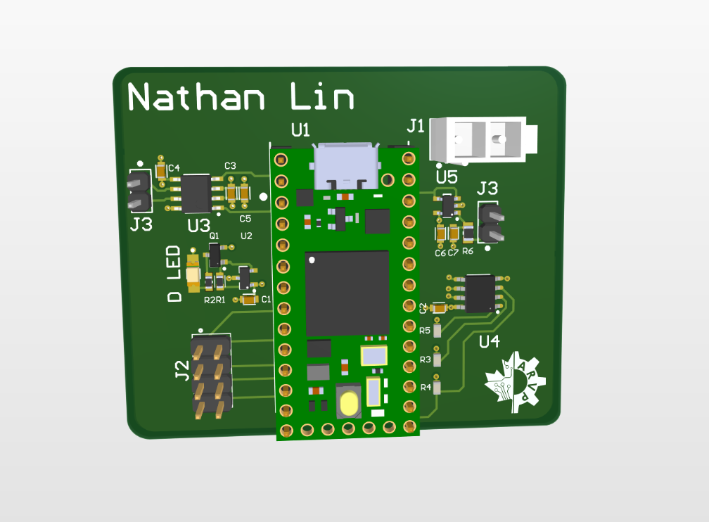
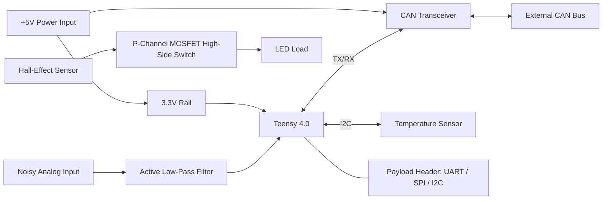
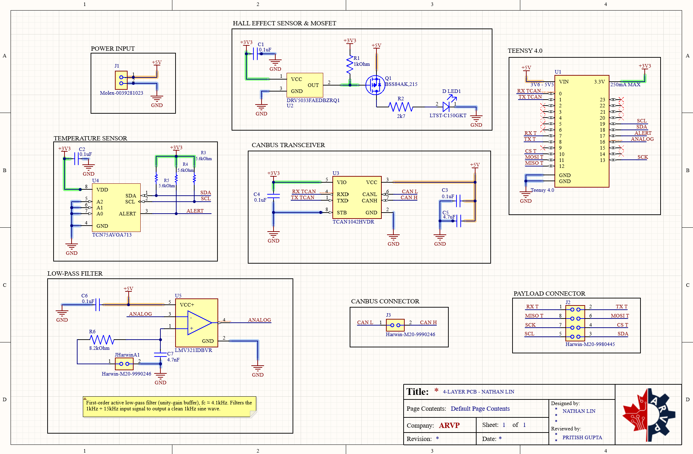
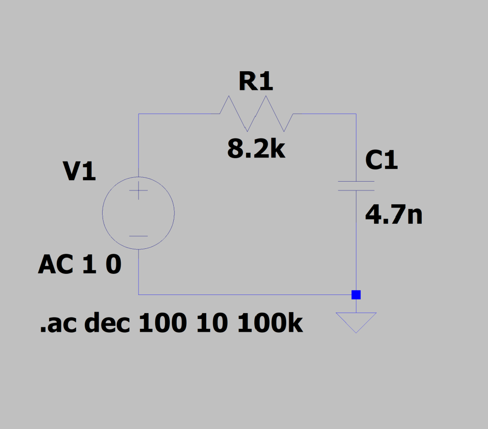
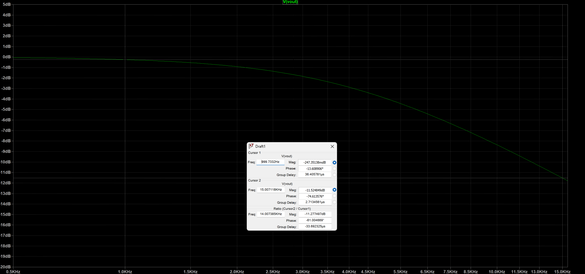

# Multi-Domain 4-Layer PCB (Teensy 4.0 | CAN Bus | Analog Filtering | Hall-Effect Switching)

A 4-layer mixed-signal PCB designed end to end in **Altium Designer**, from schematic capture through layout, routing, and design rule checks. Built as part of my onboarding with the **University of Alberta Autonomous Robotic Vehicle Project (ARVP)**, where the same circuit blocks are used on the team's underwater robot.

> **Fill-in guide:** anything marked `✏️ FILL IN` needs your own words or numbers. Delete the prompt text once you've written your response. Delete this note before publishing.

---

## Table of Contents

- [Overview](#overview)
- [Board at a Glance](#board-at-a-glance)
- [System Architecture](#system-architecture)
- [Subsystems](#subsystems)
- [PCB Design Details](#pcb-design-details)
- [Verification](#verification)
- [Challenges and How I Approached Them](#challenges-and-how-i-approached-them)
- [Key Takeaways](#key-takeaways)
- [Future Improvements](#future-improvements)
- [Repository Structure](#repository-structure)
- [Tools and Resources](#tools-and-resources)
- [Acknowledgments](#acknowledgments)
- [Contact](#contact)

---

## Overview

This board integrates four circuit domains around a Teensy 4.0 microcontroller: digital communication (CAN bus), I2C sensing, analog signal conditioning, and magnetically triggered high-side load switching. Each block mirrors a subsystem used in ARVP's robot (control board, sonar board, and the magnetic kill switch).

**Why this project:**
I took on ARVP’s electrical onboarding project because I wanted to learn how a real PCB gets designed, not just how circuits work on paper. Going from schematic to a manufacturable 4-layer board in Altium, the same workflow ARVP uses on its robots, was the best way to get there. It was also the requirement for joining the electrical team, which I wanted anyway.

**My role:**
I did the full design myself, start to finish. That covers the schematic (Teensy 4.0, CAN bus transceiver, I2C temperature sensor, hall-effect-triggered high-side load switch, active low-pass filter, power input, and payload connector), the 4-layer PCB layout and routing, and the design rule and electrical checks. I also simulated the filter in LTspice, did the silkscreen, and kept design documentation along the way. The team gave me a high-level block diagram, a component library, and tutorials to follow, so the system requirements and part selection came from them. The pin mapping, filter values, placement, routing, and fixing every DRC/ERC error were on me.

---

## Board at a Glance

| Item | Detail |
|---|---|
| EDA tool | Altium Designer |
| Layer count | 4 (Signal / Ground / Power / Signal) |
| Microcontroller | Teensy 4.0 |
| Supply input | +5 V via 2-pin Molex connector |
| Logic level | 3.3 V (Teensy pins are not 5 V tolerant) |
| Communication | CAN bus, I2C, plus UART/SPI/I2C payload header |
| Analog | Active low-pass filter into Teensy ADC |
| Board dimensions | 2.34 in x 1.94 in |
| Component count | 24 |

<p align="center">
  
</p>

## System Architecture



> ✏️ FILL IN: Replace or supplement the diagram above with your own high-level diagram if you made one, and confirm how the 3.3 V rail is generated on your board (Teensy onboard regulator or another source) so the diagram is accurate.

---
<p align="center">
  
</p>

## Subsystems

### 1. Microcontroller: Teensy 4.0
Plug-in system-on-module that handles control, communication, and ADC sampling. Pin assignments were chosen from the Teensy pinout to match each peripheral's required function (I2C, CAN TX/RX, ADC, SPI, UART).

**Pin assignments:** I matched each function to the Teensy pin that has the hardware peripheral for it, so nothing is bit-banged.
- Pins 0 / 1: CAN2 RX / TX to the TCAN1042HV
- Pins 7 / 8: UART RX / TX to the payload header
- Pins 10-13: SPI (CS, MOSI, MISO, SCK) to the payload header
- Pins 18 / 19: I2C SDA / SCL, shared by the temp sensor and payload header
- Pin 17: TCN75A ALERT as a GPIO
- Pin 16: filtered analog signal into the ADC

Unused pins are marked no-connect.

### 2. I2C Temperature Sensor: TCN75A
Digital temperature sensor on the I2C bus.

**Address and pull-ups:** A2, A1, A0 are all tied to GND, so the sensor sits at 0x48. SDA, SCL, and the open-drain ALERT output each get a 5.6 kΩ pull-up to 3.3 V. That's in the normal 4.7-10 kΩ range for 3.3 V I2C: stiff enough for clean edges at 100 kHz, weak enough that the sensor's sink current stays well under its limit. A 0.1 µF cap sits on VDD.

### 3. CAN Bus: TCAN1042HV transceiver
Gives the Teensy CAN communication over a differential CAN-H / CAN-L pair on a 2-pin header. The transceiver's **VIO pin** is used to level-shift the RXD/TXD lines so the Teensy only sees 3.3 V logic while the transceiver runs from 5 V.

**Termination:** None on this board. J3 only breaks out CAN H / CAN L, so it's a node on the bus, and the 120 Ω terminators go at the two physical ends of the bus.

**VIO:** VCC (pin 3) runs from 5 V and VIO (pin 5) from the Teensy's 3.3 V, so TXD / RXD logic is 3.3 V and the Teensy never sees 5 V on its pins. STB is tied to GND to keep the transceiver in normal mode. Decoupling is 0.1 µF on VIO and 0.1 µF + 4.7 µF on VCC.

### 4. Active Low-Pass Filter: LMV321 op-amp
Non-inverting, unity-gain op-amp filter that passes a **1 kHz** sine wave and rejects **15 kHz** noise before the signal reaches a Teensy analog input. Input swings between 1 V and 3 V, so no negative supply is needed and the output stays inside the Teensy's 0 to 3.3 V range.

| Parameter | Value |
|---|---|
| Topology | First-order active low-pass (unity-gain buffer) |
| Cutoff frequency | ≈ 4.13 kHz |
| Resistor / capacitor values | R = 8.2 kΩ, C = 4.7 nF |
| Simulated attenuation at 15 kHz | -11.5 dB (LTspice) |

**How I picked the values:**
- **Cutoff:** about 4.1 kHz, close to the geometric mean of the 1 kHz signal and the 15 kHz noise (√(1 kHz × 15 kHz) ≈ 3.9 kHz).
- **Result:** the 1 kHz signal stays within about 0.25 dB and the 15 kHz noise drops about 11.5 dB.
- **Trade-off:** a lower cutoff cuts more noise but starts eating into the signal. A first-order filter can't do better on both, so second-order is the natural next step.
- **Values:** R = 8.2 kΩ and C = 4.7 nF from the ARVP component library. fc = 1 / (2π · 8.2 kΩ · 4.7 nF) ≈ 4.13 kHz.
- **Op-amp:** a unity-gain buffer, so the Teensy's ADC input doesn't load the RC network.

<p align="center">
  
</p>

<p align="center">
  
  <br>
  <em>LTspice AC sweep of the filter's RC stage (R = 8.2 kΩ, C = 4.7 nF). Cursors read -0.25 dB at 1 kHz and -11.5 dB at 15 kHz. The op-amp is a unity-gain buffer, so I simulated the RC stage alone with an ideal source.</em>
</p>

### 5. Hall-Effect Load Switch: DRV5033 + BSS84 P-MOSFET
A hall-effect sensor with an open-drain output controls a p-channel MOSFET used as a **high-side switch**. When a magnet is near the sensor, its output pulls low, the MOSFET turns on, and the LED lights. When the magnet is removed, the output goes high-impedance, a pull-up resistor turns the MOSFET off, and the LED goes dark. This is the same principle as ARVP's magnetic kill switch.

**Pull-up (R1, 1 kΩ to +3V3):** The DRV5033's output is open-drain, so it can only pull the MOSFET gate low. R1 pulls the gate back up when the magnet is removed. 1 kΩ is inside the datasheet's allowed range (about 110 Ω to 32 kΩ at 3.3 V, and above 500 Ω so the output can pull close to ground), and it matches the resistor the datasheet uses for its switching-time specs. With a magnet present the sensor sinks about 3.3 mA, far below its 30 mA rating. The gate is pulled to roughly 0 V, so Vgs is about -5 V and the BSS84AK is fully on (RDS(on) ≈ 5.7 Ω typ at Vgs = -5 V).

**LED current limit (R2, 2.7 kΩ):** The LED runs from +5 V through the MOSFET. The LTST-C150GKT has a forward voltage of 2.1 V typ and 2.6 V max, so the current is about (5 V - 2.1 V) / 2.7 kΩ ≈ 1.1 mA (0.9 mA at the max forward voltage). That is far below the LED's 30 mA DC rating, so it's a conservative current.

**Known limitation:** Q1's source is on +5 V but R1 pulls the gate up to only 3.3 V, so in the off state Vgs is about -1.7 V. The BSS84AK's threshold is -1.1 V to -2.1 V (-1.6 V typ, measured at 250 µA), so the MOSFET is not guaranteed to turn fully off and can leak enough current to dimly light the LED. In a revision, I would tie R1 to +5 V so the off-state Vgs is 0 V. The DRV5033 allows output pull-ups up to 38 V.

### 6. Power Input and Payload Connector
- **Power:** 2-pin Molex connector supplying +5 V.
- **Payload header:** 8-pin header breaking out a UART TX/RX pair, an SPI bus (MISO, MOSI, SCLK) with a chip-select GPIO, and the shared I2C bus, so functionality can be added later without respinning the board.

---

## PCB Design Details

### Layer Stackup

| Layer | Name | Purpose |
|---|---|---|
| 1 | Top Signal | Components, signal routing, wide power traces to vias |
| 2 | Ground | Solid ground plane (reference for top-layer signals) |
| 3 | Power | +5 V and +3.3 V pours |
| 4 | Bottom Signal | Signal routing, referenced to the power plane |

### Design Rules
- Minimum clearance: 0.2 mm
- Power traces on the top layer: at least 0.5 mm (20 mil) before dropping to the power plane
- Signal traces: around 0.25 mm (10 mil)
- Bottom-layer signals routed over a +3.3 V pour so the reference plane matches the signal's voltage
- Ground connections via down to the layer 2 plane

✏️ FILL IN: Any rules you added or deviated from, and why.

### Layout Approach
✏️ FILL IN: How you placed components (Teensy first, then grouping by voltage and signal flow), where you put the analog filter relative to noisy digital sections, and where decoupling capacitors sit.

### Images

> ✏️ FILL IN: Export these from Altium and drop them in `docs/images/`, then uncomment the lines below.

<!--


-->

---

## Verification

| Check | Result |
|---|---|
| Schematic ERC | ✏️ FILL IN (errors / warnings) |
| PCB DRC | ✏️ FILL IN (violations; note any ignored items such as solder mask slivers and why) |
| LTSpice filter simulation | ✏️ FILL IN |
| Design review | ✏️ FILL IN (who reviewed, what feedback you got, what you changed) |
| Physical testing | ✏️ FILL IN, or write "Not fabricated" if that's the case. Don't claim results you don't have. |

---

## Challenges and How I Approached Them

> ✏️ FILL IN: This is the section employers read most closely. Pick 2-4 real problems. For each one, use the structure below. Specific beats impressive.

### Challenge 1: ✏️ FILL IN (short title)
- **Problem:** What went wrong or what was hard?
- **Why it mattered:** What would have happened if you got it wrong?
- **What I tried:** Including things that didn't work.
- **Solution:** What you ended up doing and why it worked.
- **What I'd do differently:**

### Challenge 2: ✏️ FILL IN
- **Problem:**
- **Why it mattered:**
- **What I tried:**
- **Solution:**
- **What I'd do differently:**

### Challenge 3: ✏️ FILL IN
- **Problem:**
- **Why it mattered:**
- **What I tried:**
- **Solution:**
- **What I'd do differently:**

<details>
<summary>Prompts if you're stuck</summary>

- Level shifting between 5 V and 3.3 V logic
- Choosing filter component values from the ARVP library
- Keeping signal return paths clean on a 4-layer stack
- Routing around the Teensy footprint
- Fixing DRC violations without breaking clearance rules
- Reading datasheets for pin functions and application circuits
- Learning Altium with no prior experience

</details>

---

## Key Takeaways

✏️ FILL IN: 3-5 bullets on what you learned technically and professionally. Example directions: reading datasheets, why stackup and reference planes matter, documenting as you work, getting feedback from design reviews.

---

## Future Improvements

✏️ FILL IN: What you'd change on a second revision. Ideas to react to, keep only what's true for you: add test points, add reverse-polarity or overcurrent protection, add ESD protection on external connectors, improve filter order, add status LEDs, tighten board outline, fabricate and bring up the board.

---

## Repository Structure

> ✏️ FILL IN: Adjust to match what you actually upload.

```
.
├── README.md
├── hardware/
│   ├── schematic/        # Altium schematic files / PDF export
│   ├── pcb/              # Altium PCB files
│   ├── gerbers/          # Manufacturing outputs (if generated)
│   └── bom/              # Bill of materials
├── simulation/
│   └── lowpass_filter.asc   # LTSpice files
└── docs/
    ├── images/
    └── design_notes.md
```

---

## Tools and Resources

- **Altium Designer**: schematic capture, PCB layout, ERC/DRC
- **LTSpice**: low-pass filter simulation
- **Datasheets**: Teensy 4.0, TCN75A, TCAN1042HV, LMV321, BSS84AK, DRV5033
- **Phil's Lab** Altium / STM32 PCB tutorial series for workflow reference

---

## Acknowledgments

- **University of Alberta ARVP** electrical team for the onboarding program and design reviews
- ✏️ FILL IN: Name anyone who reviewed your work, if they're fine with being named

*This is a personal portfolio project built during ARVP onboarding. It is not an official ARVP release, and ARVP names and logos belong to the team.*

---

## Contact

**Nathan Lin**
Electrical Engineering (Co-op), University of Alberta
[LinkedIn](https://linkedin.com/in/nathanlin27) | [GitHub](https://github.com/njlin664) | nathanlin727@gmail.com
