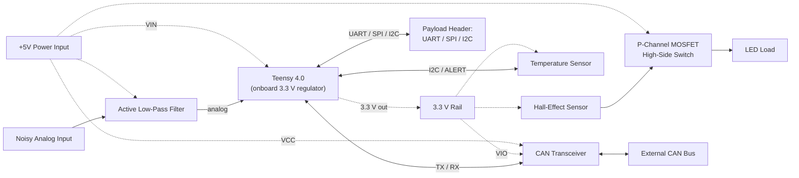
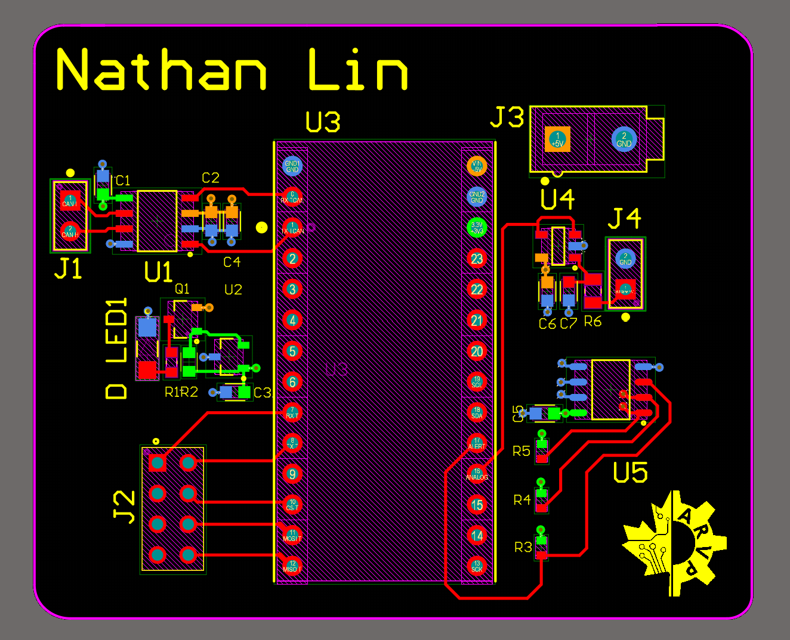
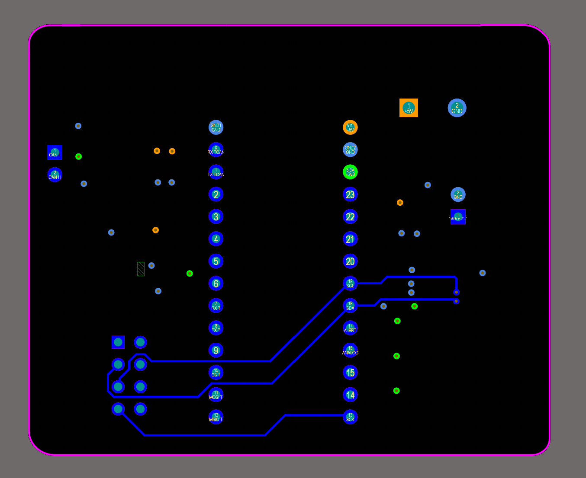
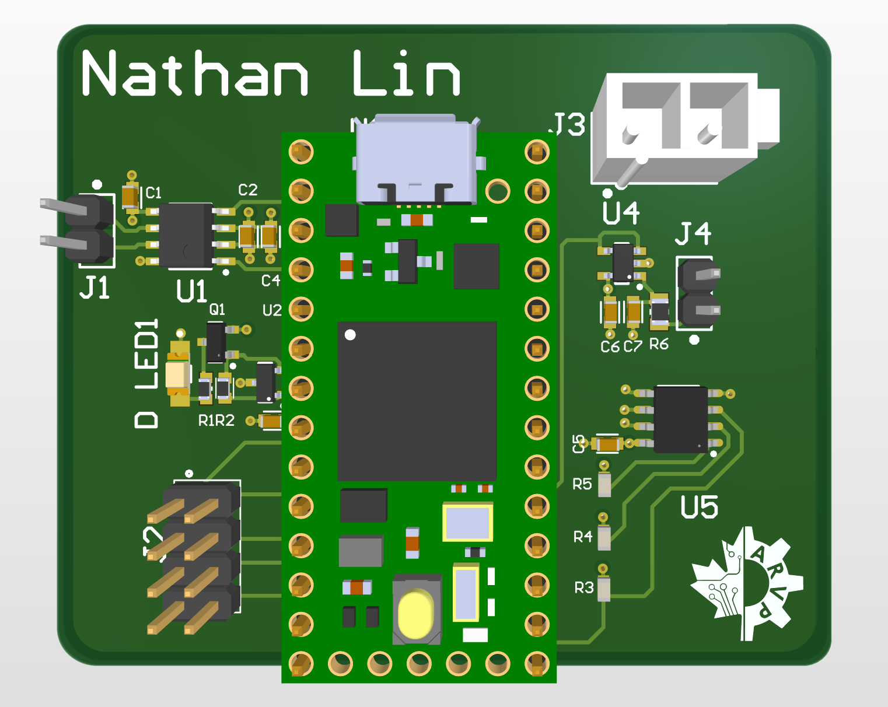

# Multi-Domain 4-Layer PCB (Teensy 4.0 | CAN Bus | Analog Filtering | Hall-Effect Switching)

A 4-layer mixed-signal PCB designed end to end in **Altium Designer**, from schematic capture through layout, routing, and design rule checks. Built as part of my onboarding with the **University of Alberta Autonomous Robotic Vehicle Project (ARVP)**, where the same circuit blocks are used on the team's underwater robot.

---

## Table of Contents

- [Overview](#overview)
- [Board at a Glance](#board-at-a-glance)
- [System Architecture](#system-architecture)
- [Subsystems](#subsystems)
- [PCB Design Details](#pcb-design-details)
- [Verification](#verification)
- [Challenges and How I Approached Them](#challenges-and-how-i-approached-them)
- [Key Takeaways](#key-takeaways)
- [Future Improvements](#future-improvements)
- [Repository Structure](#repository-structure)
- [Tools and Resources](#tools-and-resources)
- [Acknowledgments](#acknowledgments)
- [Contact](#contact)

---

## Overview

This board integrates four circuit domains around a Teensy 4.0 microcontroller: digital communication (CAN bus), I2C sensing, analog signal conditioning, and magnetically triggered high-side load switching. Each block mirrors a subsystem used in ARVP's robot (control board, sonar board, and the magnetic kill switch).

**Why this project:**
I took on ARVP’s electrical onboarding project because I wanted to learn how a real PCB gets designed, not just how circuits work on paper. Going from schematic to a manufacturable 4-layer board in Altium, the same workflow ARVP uses on its robots, was the best way to get there. It was also the requirement for joining the electrical team, which I wanted anyway.

**My role:**
I did the full design myself, start to finish. That covers the schematic (Teensy 4.0, CAN bus transceiver, I2C temperature sensor, hall-effect-triggered high-side load switch, active low-pass filter, power input, and payload connector), the 4-layer PCB layout and routing, and the design rule and electrical checks. I also simulated the filter in LTspice, did the silkscreen, and kept design documentation along the way. The team gave me a high-level block diagram, a component library, and tutorials to follow, so the system requirements and part selection came from them. The pin mapping, filter values, placement, routing, and fixing every DRC/ERC error were on me.

---

## Board at a Glance

| Item | Detail |
|---|---|
| EDA tool | Altium Designer |
| Layer count | 4 (Signal / Ground / Power / Signal) |
| Microcontroller | Teensy 4.0 |
| Supply input | +5 V via 2-pin Molex connector |
| Logic level | 3.3 V (Teensy pins are not 5 V tolerant) |
| Communication | CAN bus, I2C, plus UART/SPI/I2C payload header |
| Analog | Active low-pass filter into Teensy ADC |
| Board dimensions | 2.34 in x 1.94 in |
| Component count | 24 |

## System Architecture



Solid arrows are signals and dashed arrows are power. The 3.3 V rail comes from the Teensy 4.0's onboard regulator: +5 V from the power connector goes into the Teensy's VIN pin, and the Teensy's 3.3 V pin is the +3V3 rail. That rail powers the temperature sensor, the hall-effect sensor, the CAN transceiver's VIO pin, and the I2C pull-ups. There is no separate regulator on the board. The Teensy's 3.3 V output is limited to about 250 mA, and these loads draw only a few milliamps.

---

## Subsystems

### 1. Microcontroller: Teensy 4.0
Plug-in system-on-module that handles control, communication, and ADC sampling. Pin assignments were chosen from the Teensy pinout to match each peripheral's required function (I2C, CAN TX/RX, ADC, SPI, UART).

**Pin assignments:** I matched each function to the Teensy pin that has the hardware peripheral for it, so nothing is bit-banged.
- Pins 0 / 1: CAN2 RX / TX to the TCAN1042HV
- Pins 7 / 8: UART RX / TX to the payload header
- Pins 10-13: SPI (CS, MOSI, MISO, SCK) to the payload header
- Pins 18 / 19: I2C SDA / SCL, shared by the temp sensor and payload header
- Pin 17: TCN75A ALERT as a GPIO
- Pin 16: filtered analog signal into the ADC

Unused pins are marked no-connect.

### 2. I2C Temperature Sensor: TCN75A
Digital temperature sensor on the I2C bus.

**Address and pull-ups:** A2, A1, A0 are all tied to GND, so the sensor sits at 0x48. SDA, SCL, and the open-drain ALERT output each get a 5.6 kΩ pull-up to 3.3 V. That's in the normal 4.7-10 kΩ range for 3.3 V I2C: stiff enough for clean edges at 100 kHz, weak enough that the sensor's sink current stays well under its limit. A 0.1 µF cap sits on VDD.

### 3. CAN Bus: TCAN1042HV transceiver
Gives the Teensy CAN communication over a differential CAN-H / CAN-L pair on a 2-pin header. The transceiver's **VIO pin** is used to level-shift the RXD/TXD lines so the Teensy only sees 3.3 V logic while the transceiver runs from 5 V.

**Termination:** None on this board. J3 only breaks out CAN H / CAN L, so it's a node on the bus, and the 120 Ω terminators go at the two physical ends of the bus.

**VIO:** VCC (pin 3) runs from 5 V and VIO (pin 5) from the Teensy's 3.3 V, so TXD / RXD logic is 3.3 V and the Teensy never sees 5 V on its pins. STB is tied to GND to keep the transceiver in normal mode. Decoupling is 0.1 µF on VIO and 0.1 µF + 4.7 µF on VCC.

### 4. Active Low-Pass Filter: LMV321 op-amp
Non-inverting, unity-gain op-amp filter that passes a **1 kHz** sine wave and rejects **15 kHz** noise before the signal reaches a Teensy analog input. Input swings between 1 V and 3 V, so no negative supply is needed and the output stays inside the Teensy's 0 to 3.3 V range.

| Parameter | Value |
|---|---|
| Topology | First-order active low-pass (unity-gain buffer) |
| Cutoff frequency | ≈ 4.13 kHz |
| Resistor / capacitor values | R = 8.2 kΩ, C = 4.7 nF |
| Simulated attenuation at 15 kHz | -11.5 dB (LTspice) |

**How I picked the values:**
- **Cutoff:** about 4.1 kHz, close to the geometric mean of the 1 kHz signal and the 15 kHz noise (√(1 kHz × 15 kHz) ≈ 3.9 kHz).
- **Result:** the 1 kHz signal stays within about 0.25 dB and the 15 kHz noise drops about 11.5 dB.
- **Trade-off:** a lower cutoff cuts more noise but starts eating into the signal. A first-order filter can't do better on both, so second-order is the natural next step.
- **Values:** R = 8.2 kΩ and C = 4.7 nF from the ARVP component library. fc = 1 / (2π · 8.2 kΩ · 4.7 nF) ≈ 4.13 kHz.
- **Op-amp:** a unity-gain buffer, so the Teensy's ADC input doesn't load the RC network.

<p align="center">
  
  <br>
  <em>LTspice AC analysis simulation circuit for a passive RC low-pass filter stage. Configured with 8.2kOhm and 4.7nF components to model and verify the frequency response prior to PCB integration.</em>
</p>

<p align="center">
  
  <br>
  <em>LTspice AC sweep of the filter's RC stage (R = 8.2 kΩ, C = 4.7 nF). Cursors read -0.25 dB at 1 kHz and -11.5 dB at 15 kHz. The op-amp is a unity-gain buffer, so I simulated the RC stage alone with an ideal source.</em>
</p>

### 5. Hall-Effect Load Switch: DRV5033 + BSS84 P-MOSFET
A hall-effect sensor with an open-drain output controls a p-channel MOSFET used as a **high-side switch**. When a magnet is near the sensor, its output pulls low, the MOSFET turns on, and the LED lights. When the magnet is removed, the output goes high-impedance, a pull-up resistor turns the MOSFET off, and the LED goes dark. This is the same principle as ARVP's magnetic kill switch.

**Pull-up (R1, 1 kΩ to +3V3):** The DRV5033's output is open-drain, so it can only pull the MOSFET gate low. R1 pulls the gate back up when the magnet is removed. 1 kΩ is inside the datasheet's allowed range (about 110 Ω to 32 kΩ at 3.3 V, and above 500 Ω so the output can pull close to ground), and it matches the resistor the datasheet uses for its switching-time specs. With a magnet present the sensor sinks about 3.3 mA, far below its 30 mA rating. The gate is pulled to roughly 0 V, so Vgs is about -5 V and the BSS84AK is fully on (RDS(on) ≈ 5.7 Ω typ at Vgs = -5 V).

**LED current limit (R2, 2.7 kΩ):** The LED runs from +5 V through the MOSFET. The LTST-C150GKT has a forward voltage of 2.1 V typ and 2.6 V max, so the current is about (5 V - 2.1 V) / 2.7 kΩ ≈ 1.1 mA (0.9 mA at the max forward voltage). That is far below the LED's 30 mA DC rating, so it's a conservative current.

**Known limitation:** Q1's source is on +5 V but R1 pulls the gate up to only 3.3 V, so in the off state Vgs is about -1.7 V. The BSS84AK's threshold is -1.1 V to -2.1 V (-1.6 V typ, measured at 250 µA), so the MOSFET is not guaranteed to turn fully off and can leak enough current to dimly light the LED. In a revision, I would tie R1 to +5 V so the off-state Vgs is 0 V. The DRV5033 allows output pull-ups up to 38 V.

### 6. Power Input and Payload Connector
- **Power:** 2-pin Molex connector supplying +5 V.
- **Payload header:** 8-pin header breaking out a UART TX/RX pair, an SPI bus (MISO, MOSI, SCLK) with a chip-select GPIO, and the shared I2C bus, so functionality can be added later without respinning the board.

---

## PCB Design Details

### Layer Stackup

| Layer | Name | Purpose |
|---|---|---|
| 1 | Top Signal | Components, signal routing, wide power traces to vias |
| 2 | Ground | Solid ground plane (reference for top-layer signals) |
| 3 | Power | +5 V and +3.3 V pours |
| 4 | Bottom Signal | Signal routing, referenced to the power plane |

### Design Rules
- Minimum clearance: 0.2 mm
- Power traces on the top layer: at least 0.5 mm (20 mil) before dropping to the power plane
- Signal traces: around 0.25 mm (10 mil)
- Bottom-layer signals routed over a +3.3 V pour so the reference plane matches the signal's voltage
- Ground connections via down to the layer 2 plane

**Deviations from the onboarding guide:**
- I placed components and routed traces as close together as the manufacturer allows, using a minimum clearance of 0 mm, to keep the board compact.
- Copper pours connect to pads with Direct Connect (no thermal relief), which favors low impedance over ease of hand-soldering.

### Layout Approach
I placed the Teensy first, centered left-to-right and oriented vertically so its two pin rows face the left and right edges. Then I built each circuit around the Teensy pins it connects to, so the traces stay short:

- **Left side (digital interfaces):** The CAN transceiver (U1) and its connector (J1) sit beside the Teensy's pins 0 and 1 in the top-left corner. The payload header (J2) is at the lower left, beside the UART and SPI pins (7-12). The hall sensor, MOSFET, and LED block sits between them. It doesn't use any Teensy pins, so I put it in the free space on that side.
- **Right side (power, analog, sensing):** The 5 V power connector (J3) is at the top right, next to the Teensy's VIN pin. The analog filter (U4) and its input header (J4) are below it. The temperature sensor (U5) and its pull-ups (R3-R5) are at the lower right, beside the I2C pins (18-19) and ALERT (17).
- **Analog vs. digital:** The filter is on the opposite side of the Teensy from the CAN transceiver and the payload header, so the width of the Teensy separates it from the busiest digital interfaces.
- **Decoupling:** Each IC has its capacitors directly beside it, to keep the high-frequency current loop short.

### Images

<p align="center">
  
  <br>
  <em> PCB schematic designed in Altium Designer. Integrates a Teensy 4.0, CAN bus transceiver, active low-pass filtering, and modular payload interfaces for hardware applications.</em>
</p>

<p align="center">
  
  <br>
  <em> Top layer PCB layout routing designed in Altium Designer. Features compact component placement, signal-isolated trace routing, and structured grouping around the central Teensy 4.0 footprint.</em>
</p>

<p align="center">
  
  <br>
  <em> Bottom layer trace routing layout designed in Altium Designer. Presents strategic via placement and clean signal routing for high-speed SPI and I2C lines to minimize crosstalk and layer transitions.</em>
</p>

<p align="center">
  
  <br>
  <em> 3D mechanical model visualization rendered in Altium Designer. Showcases physical component clearances, socketed Teensy 4.0 integration, and connector layout for enclosure fit and assembly verification.</em>
</p>

---

## Verification

| Check | Result |
|---|---|
| Schematic ERC | 0 errors, 0 warnings (Altium Validate, final schematic) |
| PCB DRC | 0 violations except 26 Minimum Solder Mask Sliver items, which I ignored per the onboarding guide (they flag narrow mask between closely spaced pads). Run against the final rules. |
| LTSpice filter simulation | AC sweep of the RC stage (8.2 kΩ, 4.7 nF): -0.25 dB at 1 kHz, -11.5 dB at 15 kHz. Calculated fc ≈ 4.13 kHz. The op-amp is treated as an ideal unity-gain buffer. |
| Design review | Design reviewed by Pritish Gupta (Electrical Co-lead). Changes include: via placement, circuit trace resizing, and clearance adjustments |

---

## Challenges and How I Approached Them

### Challenge 1: Making datasheet numbers decide the circuit

- **Problem:** Datasheets list dozens of parameters, and the hard part was knowing which ones decide the design. The hall-sensor switch was the test: a DRV5033 open-drain output drives a BSS84AK P-MOSFET's gate, so I had to work out the pull-up resistor and the gate voltage instead of copying a reference circuit.
- **Why it mattered:** This circuit is the basis of ARVP's magnetic kill switch. If the MOSFET doesn't fully turn off when the magnet is removed, the load never fully turns off.
- **What I tried:** I used the DRV5033 datasheet to size R1 (the allowed range is Vref / 30 mA to Vref / 100 µA, and above 500 Ω, so 1 kΩ works at 3.3 V) and to confirm the output can be pulled up to a different supply than VCC. Then I compared my gate voltage against the BSS84AK's threshold table.
- **Solution:** The comparison exposed a problem. R1 pulls the gate to 3.3 V, but the MOSFET's source is on 5 V, so the off-state Vgs is about -1.7 V. The BSS84AK's threshold is -1.1 V to -2.1 V (-1.6 V typical), so fully off isn't guaranteed and the LED can glow dimly. I kept R1 on 3.3 V for this revision and documented the limitation here instead of hiding it.
- **What I'd do differently:** Tie R1 to +5 V (the DRV5033 allows pull-ups up to 38 V) so the off-state Vgs is 0 V. I'd also check gate-drive voltage against the MOSFET's threshold table at the schematic stage, before layout.

### Challenge 2: Routing signals across the Teensy footprint

- **Problem:** The Teensy 4.0 is a large through-hole module in the middle of the board, with pins on both sides. Several signals had to cross it: the payload header (J2) is on the left, while the I2C pins (SDA, SCL) and SCK are on the right.
- **Why it mattered:** Through-hole pins pass through every layer, so the module blocks routing on all four. Long detours around it add trace length and noise, and a trace that crosses a gap in its reference plane loses its return path.
- **What I tried:** Routing around the outside of the module on the top layer with the minimum lenght of trace used. Routing through the module with smaller traces.
- **Solution:** I routed those signals on the bottom layer, between the Teensy's two pin rows, and used vias to return to the top layer at each end. That kept them short and out of the way of the top-layer routing.
- **What I'd do differently:** Map which Teensy pins each connector's signals use before placing anything, then put each connector on the same side as its pins so fewer signals have to cross the module.

### Challenge 3: Getting a DRC pass that means something

- **Problem:** I had two rule problems. I set silk-to-silk and silk-to-solder-mask clearance to 0 mm, which switched off the check that would catch overlapping designators (R1 and R2 ran together). Separately, I'd entered the guide's trace-width and via values in mils instead of millimeters, so the width rule actually read Min = 0.005 mm.
- **Why it mattered:** DRC is the last check before manufacturing. A pass against weakened rules gives false confidence, and I'd have shipped overlapping labels and unenforced width limits without knowing.
- **What I tried:** With the silk rules at 0 mm, DRC showed only the 26 solder mask slivers. When I restored the guide's 0.254 mm values, it surfaced 6 real violations (4 silk-to-solder-mask, 2 silk-to-silk).
- **Solution:** I moved the silkscreen text instead of loosening rules, re-entered the width and via rules with explicit mm units, and re-ran DRC. [Final result: only the 26 solder mask slivers remain, which the guide allows to ignore.]
- **What I'd do differently:** Keep the guide's rule values from the start and leave them alone. I'd also read the rule text printed in the DRC report (the Min=0.005 mm line was visible the whole time) and run DRC after each stage of placement and routing instead of at the end.

---

## Key Takeaways

- **Check the numbers, not just the topology.** Comparing the MOSFET's gate voltage against the BSS84AK's threshold table showed that my hall-sensor switch isn't guaranteed to turn fully off (the gate is pulled to 3.3 V while the source sits at 5 V). I wouldn't have caught that by copying a reference circuit.
- **A passing check is only as good as its rules.** I entered the width and via rules in the wrong units, and I had silkscreen clearance set to 0 mm, which hid overlapping labels. A clean DRC against weakened rules proves nothing, so I now read the rule text in the report, not just the violation count.
- **Calculate first, then simulate.** I derived the filter's cutoff by hand (≈4.13 kHz) and confirmed it in LTspice (-0.25 dB at 1 kHz, -11.5 dB at 15 kHz). Matching numbers from two independent methods gave me confidence in the design.
- **Reference planes shape the layout.** The guide's stackup puts signals on the outer layers over ground and a +3.3 V pour, so a signal always has a return path directly beneath it. That affected where I routed things and where I could change layers.
- **Design review catches what you can't see yourself.** Pritish's feedback led to changes in via placement, routing, and clearances that I hadn't spotted on my own.

---

## Future Improvements

- **Fix the hall-switch gate drive.** Move R1's pull-up from +3V3 to +5V so the MOSFET's off-state Vgs is 0 V and the LED goes fully dark.
- **Add test points** on +5V, +3V3, GND, the filter output, and the CAN lines. The board has none, so debugging would mean probing small pads.
- **Add reverse-polarity protection** on the 5 V input. J1 feeds the Teensy's VIN directly, so a swapped connector would hit it with reverse voltage.
- **Add ESD protection** on the external connectors (J1 to J4), starting with the CAN lines.
- **Upgrade the filter to second order.** A Sallen-Key design at the same cutoff should attenuate 15 kHz by about 22 dB (calculated), compared to 11.5 dB now.
- **Add an optional 120 Ω CAN termination** with a jumper, so the board can sit at the end of a bus as well as in the middle.

---

## Repository Structure

> ✏️ FILL IN: Adjust to match what you actually upload.

```
.
├── README.md
├── hardware/
│   ├── schematic/        # Altium schematic files / PDF export
│   ├── pcb/              # Altium PCB files
├── production/
│   ├── gerbers/          # Manufacturing outputs (if generated)
│   └── bom/              # Bill of materials
├── simulation/
│   └── lowpass_filter.asc   # LTSpice files
└── docs/
    └── images/
```

---

## Tools and Resources

- **Altium Designer**: schematic capture, PCB layout, ERC/DRC
- **LTSpice**: low-pass filter simulation
- **Datasheets**: Teensy 4.0, TCN75A, TCAN1042HV, LMV321, BSS84AK, DRV5033
- **Phil's Lab** Altium / STM32 PCB tutorial series for workflow reference

---

## Acknowledgments

- **University of Alberta ARVP** electrical team for the onboarding program and design reviews
- Pritish Gupta ARVP Electrical Co-lead for giving feedback on the design process

*This is a personal portfolio project built during ARVP onboarding. It is not an official ARVP release, and ARVP names and logos belong to the team.*

---

## Contact

**Nathan Lin**
Electrical Engineering (Co-op), University of Alberta
[LinkedIn](https://linkedin.com/in/nathanlin27) | [GitHub](https://github.com/njlin664) | nathanlin727@gmail.com
